# Implementation check (generated)

Made by `apps/desktop/tests/e2e/visual.spec.ts` (`npm run e2e`). Each picture shows three
parts, from left to right: the locked design, the app, and the difference in red. The QR code
is hidden in both (the design has a fixed picture, the app draws the real code). Limit: 1% of pixels.

| Screen | File | Different pixels | Picture |
|---|---|---|---|
| L01 | L01-welcome | 0.00% | 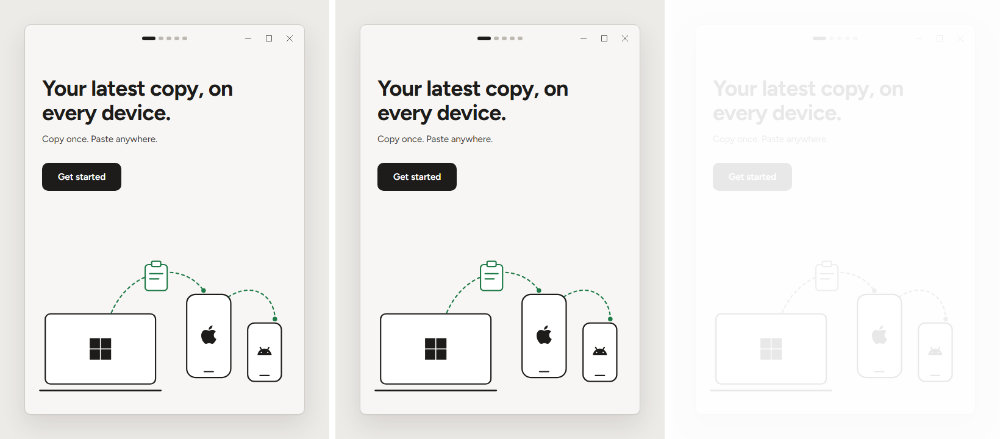 |
| L02 | L02-permissions | 0.00% | 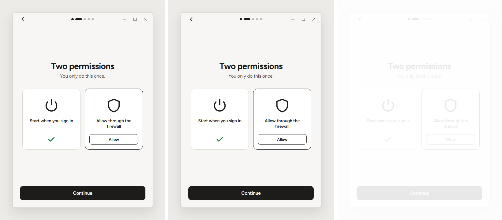 |
| L03 | L03-add | 0.00% | 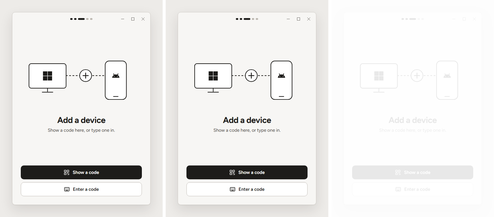 |
| L04 | L04-show-code | 0.00% | 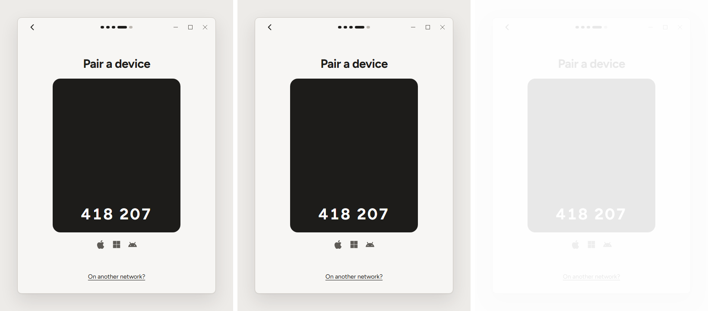 |
| L05 | L05-enter-code | 0.00% | 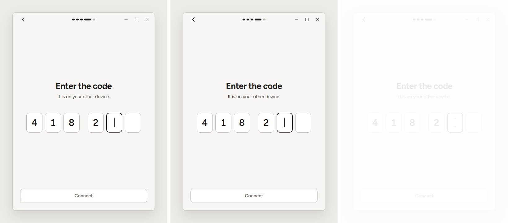 |
| L06 | L06-connected | 0.00% | 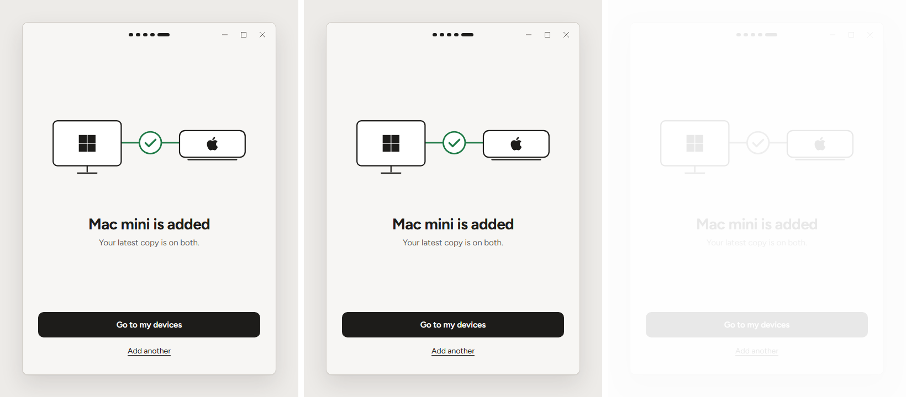 |
| L07 | L07-home | 0.00% | 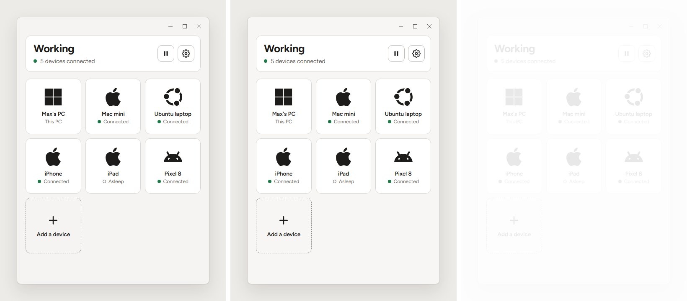 |
| L08 | L08-device | 0.00% | 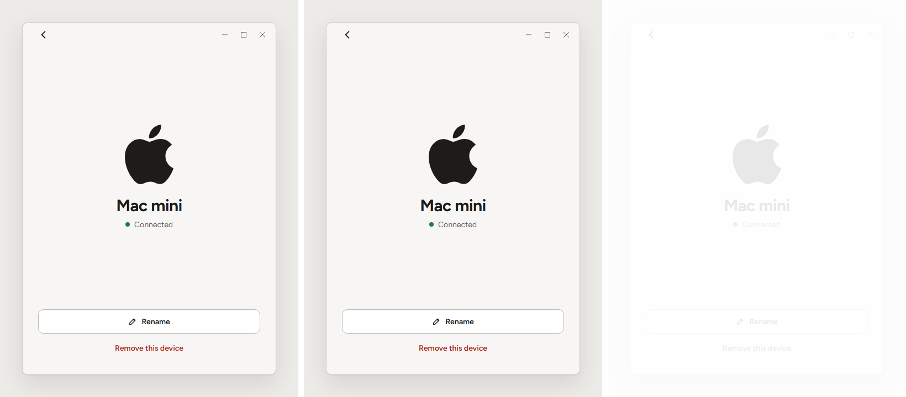 |
| L09 | L09-settings | 0.00% | 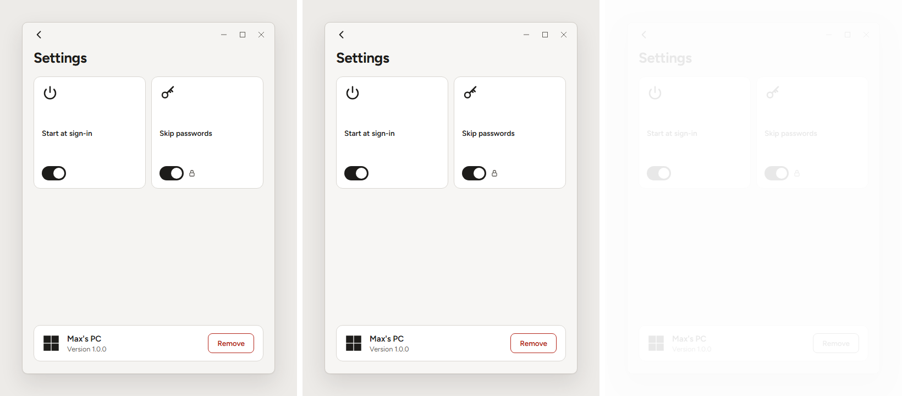 |
| L10 | L10-paused | 0.00% | 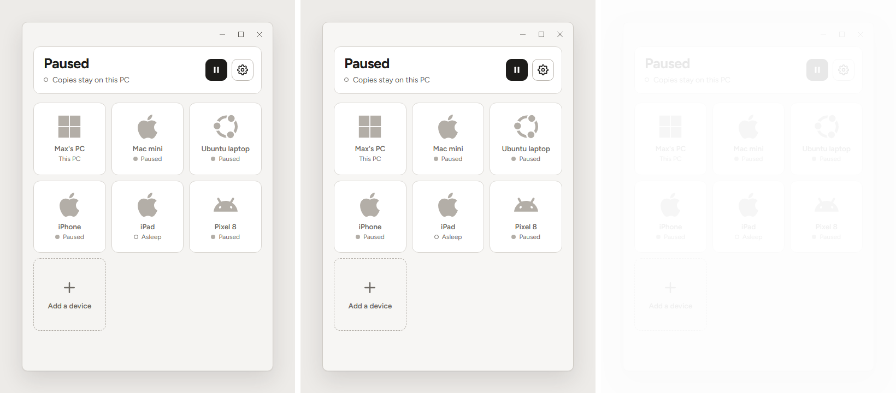 |
| L11 | L11-attention | 0.00% | 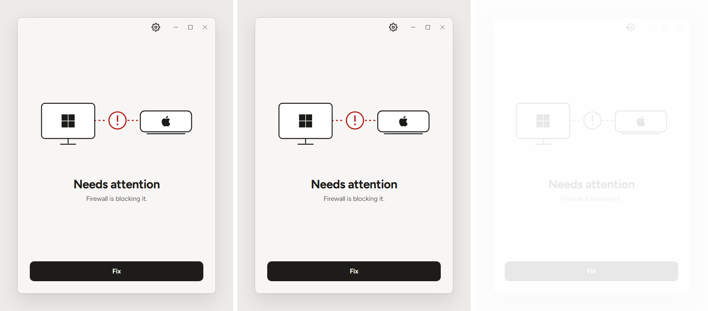 |
| L12 | L12-other-network | 0.00% | 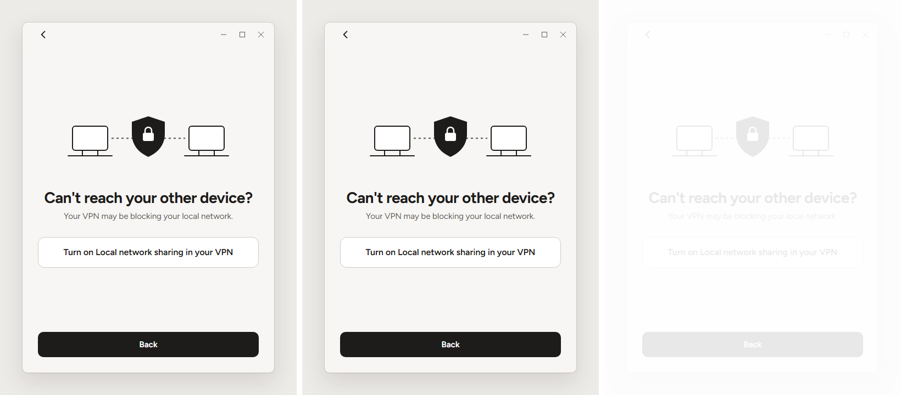 |
