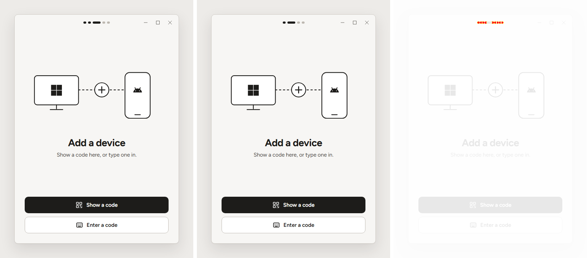
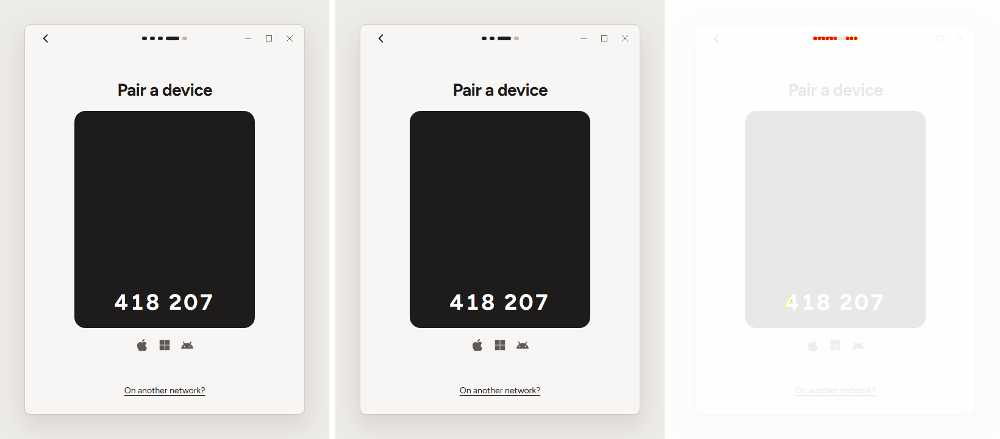
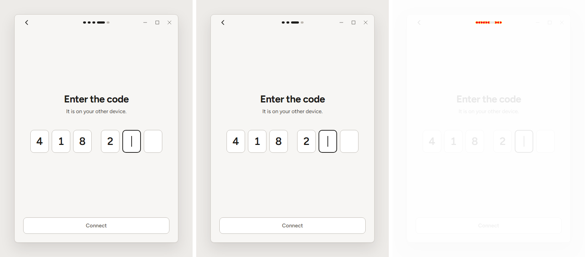
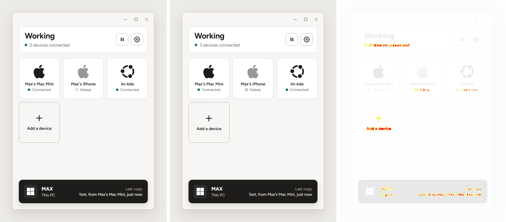
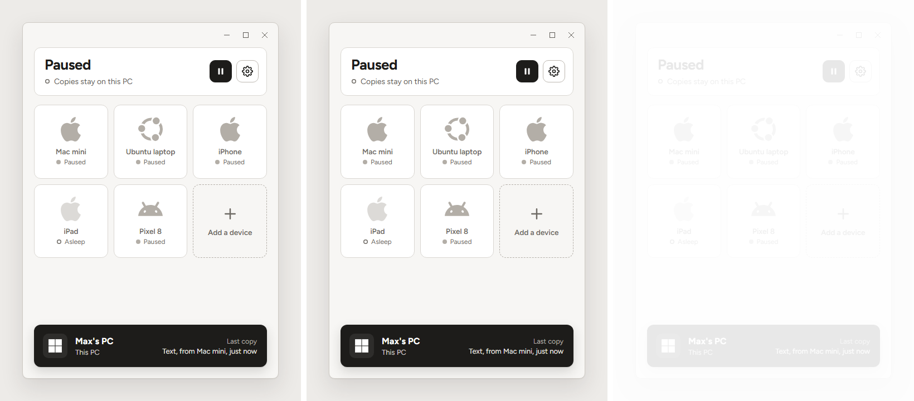
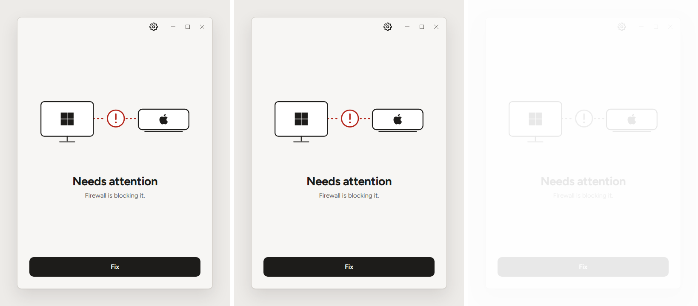
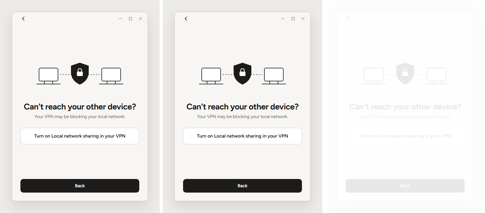

# Implementation check (generated)

Made by `apps/desktop/tests/e2e/visual.spec.ts` (`npm run e2e`). Each picture shows three
parts, from left to right: the reference, the app after its motion has settled, and the
difference in red. The reference is the locked design, except Home (L07), which is the end
frame of the H3 "You are here" motion mockup (picked 2026-11-14), and Paused (L10), which is a
picture of the app (`tests/e2e/baselines`) because no design shows Paused in the H3 layout.
The QR code is hidden in both (the design has a fixed picture, the app draws the real code).
Limit: 1% of pixels.

| Screen | File | Reference | Different pixels | Picture |
|---|---|---|---|---|
| L01 | L01-welcome | locked design | 0.06% |  |
| L02 | L02-permissions | locked design | 0.93% |  |
| L03 | L03-add | locked design | 0.06% |  |
| L04 | L04-show-code | locked design | 0.06% |  |
| L05 | L05-enter-code | locked design | 0.06% |  |
| L06 | L06-connected | locked design | 0.06% |  |
| L07 | L07-home | H3 mockup end frame | 0.27% |  |
| L08 | L08-device | locked design | 0.00% |  |
| L09 | L09-settings | locked design | 0.00% |  |
| L10 | L10-paused | app baseline (H3 layout, paused) | 0.00% |  |
| L11 | L11-attention | locked design | 0.00% |  |
| L12 | L12-other-network | locked design | 0.00% |  |
